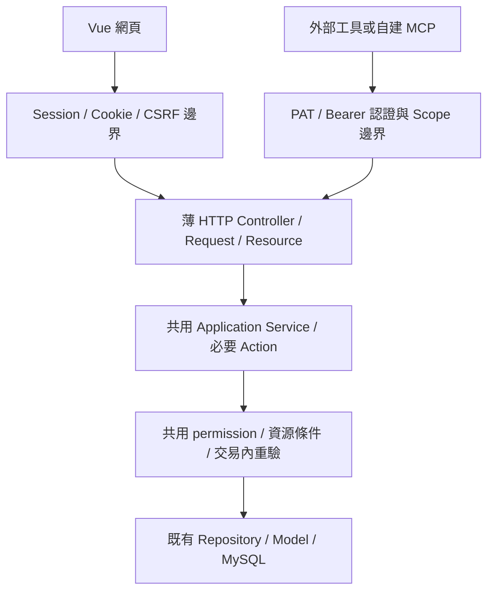

# API-first平台架構與第三方整合邊界

日期：2026-11-11。狀態：**使用者已確認產品方向，尚未實作PAT或公開REST API**。本文件採用使用者提供GPT討論的最後收斂，取代先前「TaskTracker自行提供MCP與工具整合」的候選順序；保留前段討論作沿革。

## 產品責任

TaskTracker提供完整的任務管理能力與可被整合的標準介面。使用者可以自行用Codex／Claude、VS Code、Discord／Slack機器人、n8n、GitHub Actions或自己的程式呼叫；平台不維護這些工具的專屬邏輯，也不替使用者編排AI工作。

| 項目 | 已確認範圍 |
| --- | --- |
| RESTful API | 必須；可穩定取得和操作有權限的專案／卡片等資源 |
| 每位使用者自行管理PAT | 必須；建立、命名、能力／資源Scope、有效期與撤銷 |
| Project成員與有效permission驗證 | 必須；Web與API共用規則，Token不提權 |
| Token到期／撤銷管理 | 必須；不以無限期且不可撤銷的密碼代替 |
| OpenAPI／Swagger | 建議提供OpenAPI契約；Swagger UI是呈現選項，不強制額外常駐服務 |
| TaskTracker自建MCP Server | 暫不製作；使用者可依公開API自行建立 |
| Codex／Claude或其他工具專屬整合 | 不在產品範圍；提供工具中立的契約與範例 |
| Agent編排／自動化工作流程 | 不在產品範圍；保留外部操作來源稽核 |
| Webhook | 後續低優先候選，先完成Token與API；不因此宣稱已有可靠投遞 |

先前V3自建MCP不再是本專案既定開發階段。外部Multi-Agent可作後續選配聯調客戶端，但其自身功能、MA-79結案或客戶端adapter不是TaskTracker基礎API的驗收阻擋條件。

## Web與API共用一套應用能力

以下為目標責任流，不代表類別或路由已建立：

- 網頁與外部API共用Service／Action、集中授權、資料存取、revision／requestId／歷史及交易邊界。不同Controller只適配認證、輸入與輸出，不複製第二套建立／移動／留言流程。
- 認證確定使用者及Token來源；由伺服器建立可信的操作者與Workspace／Project上下文，再驗證範圍。外部請求不能自行指定可放行的角色或跨租戶工作區。
- 外部Token不應依賴人類瀏覽器Session的「目前工作區」。請求的目標資源、Token範圍與使用者有效成員資格必須一致；具體路徑／header形式於契約設計時定案。
- 共用邏輯不等於必須同一條HTTP路由。先盤點現有API，適合的能力直接重用，格式或認證不適合公開的入口才補薄REST adapter；不強迫另開一個後端服務，也不讓所有SPA RPC自動對Token開放。
- 2026-11-12契約修正：Session／CSRF、camelCase／ok-data、錯誤及revision／requestId語意維持；使用者已授權依資料存取審查調整路徑／DTO與前端依賴、退役整包RPC。一般頁面不得預設取整個Workspace，列表SQL篩選／分頁、詳細活動按需；版本與移轉步驟見[分責契約](query-api-v1.md)，不能為相容永久保留過量載入。
- Repo只負責資料存取；既有Service不因外部入口繞過權限、作者限制或MySQL寫入鎖。遵循本專案[Laravel Architecture](../skills/laravel-architecture/SKILL.md)，不機械增加空層。

## Token的授權語意

**有效操作 = 使用者當下有效permission ∩ Token能力 ∩ Token指定的Workspace／Project範圍，並符合資源／作者條件。**

例如使用者只有專案A的讀取權，即使Token宣告寫入能力仍不能寫A，也不能讀B；退出A、被停用或撤權後，舊Token對A也不能繼續使用。角色只是permission映射，不能用角色名稱代替檢查。

PAT管理屬於個人帳號能力；Scope不超出本人可授予能力。第一版可用使用者ID＋Token ID／名稱記錄操作來源，不能因需要稽核就先引入Agent run編排或複雜整合身分平台。Token原文僅建立時顯示、保存雜湊，寫入仍使用既有版本與防重送機制。

Laravel Sanctum是優先評估的既有認證機制；套件版本、Token儲存擴充、與現有HTTP／Session邊界的接法於實作前盤點。本次沒有安裝或產生Token。

### 2026-11-12 使用者確認的PAT第一版規則

| 項目 | 使用者已確認 |
| --- | --- |
| Scope | 第一版只分`read`／`write`，`write`隱含`read`；Scope以清單儲存，細項之後擴充 |
| 期限 | 預設1個月，最長2年；不提供無期限 |
| 過期處理 | 只在Token管理頁顯示已過期，不主動通知；不提供延長，過期後由使用者新建；過期API回401 |
| 綁定範圍 | 綁定整個Workspace，代表該使用者；一人多個Workspace需各自建立Token；實際可見Project仍是本人當下有效Project資格，不因Workspace綁定提權 |
| 刪除 | 公開API第一版不提供刪除，與網頁現況一致只以狀態closed結案；系統與API的刪除／封存見TT-250，後期設計 |

輪替機制、Token數量上限仍待實作設計，不把上游預設直接當產品需求。先前官方查證見[Sanctum文件](https://laravel.com/framework/docs/13.x/sanctum)。

## 漸進式交付

1. **盤點與契約**：對照現有查詢／寫入用例與授權入口，決定資源、版本、錯誤、分頁與認證邊界；列出最小必要調整。
2. **PAT與必要REST能力**：Token管理、Scope、到期／撤銷，身分／權限metadata、專案與狀態清單、單卡／可篩選分頁查詢，以及必要寫入／留言／關聯操作。未授權與跨專案拒絕、撤權、衝突及重送可驗證。
3. **文件與互通驗收**：以工具中立的HTTP範例及建議的OpenAPI描述契約，任意受限客戶端可完成讀寫與錯誤處理；不依賴特定模型、DOM或Vite模組。
4. **後續增量能力**：externalId、批次／增量與可靠Webhook按需求逐項排程。Webhook要有獨立可靠投遞設計，不能把Reverb視為替代品。MCP與工具端adapter留給外部。

「完整CRUD」中的刪除／封存仍需先定義資料保留、歷史與關聯語意（2026-11-12使用者確認後期另卡處理，前期非必要）；目前沒有此公開端點，不能為湊HTTP動詞直接硬刪既有卡片。這個待決語意不影響先交付安全的讀取／建立／更新能力。

## 卡片與沿革

- TT-165：PAT管理與Scope；TT-166：使用者／Token來源稽核與撤權；TT-167：公開REST契約；TT-168／169：查詢與寫入。功能尚未完成，維持待辦。
- TT-171～173的外部識別／批次／增量仍是後續平台能力，未因本次方向直接實作。
- TT-174／175的Webhook與TT-177外部客戶端聯調暫緩；TT-176保留通用整合來源稽核，排除內建Agent工作流。
- TT-203只追蹤本輪架構決策與卡片同步，規劃交付完成才結案；不以它結案宣稱PAT或REST已完成。
- 初次202卡的[來源清單](planning/tasktracker-backlog.json)及[匯入結果](planning/tasktracker-import-result.json)保留為歷史快照，實際進度以Tracker為準。本輪不修改原始Multi-Agent交接報告或他專案卡片。

來源：[使用者先前產品討論](產品討論紀錄.md)、[Multi-Agent實測交接](../Multi-Agent-To-Tracker.md)與本輪最後確認。部署重構是另一條工作線，本次沒有調整Compose、Reverb、主庫或雲端環境。

## 本輪規劃交付驗證

已完成文件與README／架構／AGENTS入口同步、本地連結及diff檢查；以taskTrackerAI更新並讀回10張既有整合卡的最新範圍、指派與狀態。TT-174／175／177為deferred／low，其餘核心卡維持open；規劃子卡TT-203留言交接後closed。沒有將文件結案誤作API功能完成，初次匯入快照不重寫。未安裝套件、修改產品程式／schema／部署或操作其他專案卡片；純文件不額外跑產品測試。
