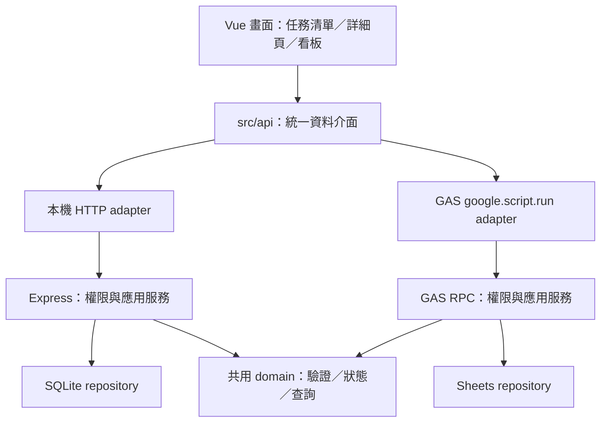

# TaskTracker 架構提案

日期：2026-10-05（Asia/Taipei）

GAS Web App 是使用者已確認的長期方向, 本文件最初為參考 GuildManager 的提案。使用者後續要求先驗證本機版本, 再產生 `.gs`；目前已實作 Vue＋Vite、本機 Node HTTP API＋SQLite 與共用 domain, GAS 功能尚未實作或部署

本機實際實作使用 Node 內建 `node:http`、`node:sqlite`, 原生 CSS 取代 UI 框架。下方 Express、Sheets、GAS 打包與團隊登入仍是後續提案, 不代表目前程式已提供

2026-10-06 已依使用者要求改成專案入口：`#/` 為專案列表, `#/projects/<projectId>` 提供該專案的任務清單／看板, 任務詳細內容使用 `#/projects/<projectId>/issues/<issueId>`。原 `#/issue/<issueId>` 在載入時轉至所屬專案, 所有任務操作保留專案上下文

## GuildManager 實際參考結果

已讀取相鄰專案的 `Architecture.md`、`README.md`、`package.json`、`vite.config.js`、`tools/package-gas.js`、`src/api/gas.js`、`gas/Code.gs`、`gas/appsscript.json`、`gas/src/backend.js` 與 `gas/src/storage.js`

| 層級 | GuildManager 實際做法 | TaskTracker 提案 |
| --- | --- | --- |
| 前端 | Vue、Vuetify、Vite | 沿用 Vue＋Vite, UI 套件另確認 |
| 本機 | Express API＋SQLite, Docker Compose | 沿用可離線開發的本機 API 與 repository |
| API adapter | `src/api/` 切換 HTTP 與 GAS RPC | 同一任務 DTO, 分別實作兩個 transport |
| 共用規則 | `src/domain/` 可由本機及 GAS 匯入 | 共用任務驗證、狀態規則與查詢正規化 |
| GAS 前端 | 單一 `Index.html`, JS／CSS 內嵌 | 相同打包方向, 驗證無相對資源遺漏 |
| GAS 後端 | domain 與 GAS 來源打包成 `Backend.gs`, `Code.gs` 提供 RPC 入口 | RPC 採明確 allowlist, 內部函式不直接暴露 |
| 雲端儲存 | Sheets store、固定 ID、分塊 payload、提交日誌；部分私有資料使用 Script Properties | 沿用一致性設計原則, 實際儲存格式待選定 |
| 登入 | 自有帳密及應用 session, 本機與 GAS 使用不同機制, 非 Google OAuth | 不直接複製, 先決定 TaskTracker 的登入情境 |

參考架構與實際來源都有讀取, 沒有複製帳號、Script ID、試算表 ID 或幫會業務

## 建議分層



| 層級 | 本機 | GAS Web App |
| --- | --- | --- |
| 頁面入口 | Vite dev server | `doGet()` 回傳 HTML Service 頁面 |
| 通訊 | HTTP JSON | 非同步 `google.script.run`, adapter 包成 Promise |
| 權限 | 本機 session／測試身分 | 正式登入與應用權限, 方案待確認 |
| 持久化 | SQLite | Google 試算表 |
| 多筆一致性 | SQL transaction | Script lock＋版本檢查＋提交／恢復機制 |
| 驗證 | 本機整合測試 | mock 契約測試＋隔離試算表的真實部署驗證 |

畫面不直接呼叫 SQL、Sheets 或 RPC, 平台差異集中在 adapter 與 repository。GAS 使用 V8, Node 的 `fs`、Express、SQLite driver 不放入雲端 bundle。[GAS V8](https://developers.google.com/apps-script/guides/v8-runtime)

## 建議來源目錄

以下是後續實作的建議目錄, 本次不建立空白程式檔

```text
src/
  pages/                 # 專案、任務清單、任務詳細、看板
  components/            # 實際需要共用的 UI
  api/                   # HTTP／GAS adapters
  domain/                # 平台無關的資料驗證與規則
server/
  app.js                 # Express API
  repositories/          # SQLite 存取
gas/
  Code.gs                # doGet、公開 RPC wrappers
  appsscript.json         # V8、Asia/Taipei、必要 OAuth scopes
  src/                   # GAS 應用服務、權限與 Sheets 存取
tools/
  package-gas.js          # 編譯 GAS bundle
tests/                   # 契約、資料保存、權限與衝突測試
docs/
plans/
```

建議 GAS 輸出 `build/gas/Index.html`、`Code.gs`、`Backend.gs` 與 `appsscript.json`, 編譯產物不納入 Git。使用單檔插件屬於參考專案做法, 實作時再確認套件相容性與版本

## 第一版資料模型建議

| 實體 | 建議核心資料 |
| --- | --- |
| Project | UUID、不可任意變更的專案代碼、名稱、封存狀態、revision |
| User／ProjectMember | 已驗證身分 ID、專案 ID、專案角色、啟用狀態 |
| Issue | UUID、專案 ID、專案內序號、標題、描述、Type、State、Priority、Assignee、到期日、revision |
| Comment | UUID、Issue ID、作者 ID、內容、建立時間、requestId |
| IssueHistory | UUID、Issue ID、操作者、時間、欄位的前後值、同次操作 ID |
| SavedView（後續） | 所有人、名稱、結構化查詢條件、分享範圍 |

顯示編號可採 `TT-123`, 內部主鍵保留 UUID, 不使用試算表列號。專案代碼與序號的唯一性需由各平台處理；GAS 建號與保存放在同一鎖定／提交流程

API 建議回傳 camelCase DTO, 儲存欄位命名由 schema 決定。回應含 `revision`, 修改帶 `expectedRevision`；新增與追加操作帶 `requestId`。日期時刻使用 ISO 8601, 到期日使用台北日曆日期 `YYYY-MM-DD`

角色暫考慮系統管理者與專案 owner／member／viewer, 尚未定案。所有查詢、修改與統計都在後端按專案權限過濾, 儲存搜尋不應繞過權限

## GAS 必須獨立處理的差異

### 非同步 RPC 與畫面狀態

`google.script.run` 不保證多次呼叫的完成順序, 支援成功與失敗 handler, 且不接受所有物件型別。Adapter 統一錯誤格式, 畫面處理載入、失敗重試、重複送出及過期回應。[官方通訊文件](https://developers.google.com/apps-script/guides/html/communication)

看板可先採保存成功後更新畫面, 版本衝突要求重新載入並保留尚未送出的內容；是否採樂觀更新等實際需求出現再決定

### Sheets 一致性與儲存格式

Sheets 沒有 SQLite 的跨表 ACID transaction。`LockService.getScriptLock()` 可序列化同一腳本的寫入, 但不會自動回滾跨表失敗, 也不能阻止人工編輯或其他腳本。[LockService](https://developers.google.com/apps-script/reference/lock/lock-service)

建議同一次修改產生 operation ID, 在鎖內重讀資料與權限、驗證 revision／requestId, 再保存任務與異動紀錄。跨表寫入要定義可見提交標記與恢復策略, 失敗不讓讀取端看到半筆任務／歷史

儲存格式有兩個可評估方向：可讀欄位表＋pending operations, 或參考 GuildManager 的追加版本／提交日誌。前者便於人工閱覽但更新恢復較複雜, 後者需管理歷史增長與重建成本。先以任務＋異動紀錄的隔離原型比較, 不直接搬整套幫會 store

`requestId` 需記錄請求內容與結果, 同 ID 不同內容拒絕。RPC 回應遺失後可用同 ID 查回結果, 不把網路逾時當成寫入失敗

### 登入與執行身分

Google 官方允許 Web App 以部署者或訪客身分執行, 兩者使用不同的 Google 權限。以部署者執行時, `Session.getActiveUser().getEmail()` 不保證取得訪客 email, 不能直接用這個值完成跨帳號登入。[Web App 權限](https://developers.google.com/apps-script/guides/web#permissions)、[Session 限制](https://developers.google.com/apps-script/reference/base/session#getActiveUser())

| 選項 | 適用情境 | 第一個需要驗證的問題 |
| --- | --- | --- |
| Workspace 網域限制＋實測 Google 身分 | 成員都在同一網域 | 真實帳號是否可取得身分, 身分與讀寫權限是否符合需求 |
| 訪客身分執行 | 每位使用者接受 Google 授權 | 是否必須分享底層試算表, 如何維持應用層權限 |
| 部署者執行＋應用登入 | 不直接分享試算表, 允許外部成員 | session、登出撤銷、限流與身分驗證方案 |

本次不選定登入方案, 不預設公開註冊或匿名讀取專案資料。Script Properties 適合部署設定與少量秘密, 不直接作為大量使用者／session 的資料庫

### 配額、查詢與部署

官方目前列一般腳本每次執行 6 分鐘、每使用者 30 個並行執行, 配額可變動。這些是平台上限, 不是 TaskTracker 可用人數或效能保證。[GAS 配額](https://developers.google.com/apps-script/guides/services/quotas)

建議使用批次 Sheets 讀寫、清單分頁與按專案縮小查詢, 避免每張卡片各自 RPC。API 分頁不等於 Sheets 底層免掃描, 是否需要索引與快照由量測決定。[官方效能建議](https://developers.google.com/apps-script/guides/support/best-practices)

單檔前端仍在 HTML Service iframe 執行, 需實測資源載入、hash 深連結、重新整理、返回與手機畫面。[HTML Service 限制](https://developers.google.com/apps-script/guides/html/restrictions)

編譯、上傳來源、初始化試算表、建立／更新 Web App deployment 是不同動作。隔離測試環境與正式環境使用不同 ID, 不沿用 GuildManager 的部署設定

## 後續建置順序與驗證

1. 收斂 MVP 與登入情境 → 確認主要流程、成員規模、專案權限
2. 建立 Vue＋Vite、本機 API／SQLite 與空資料畫面 → 同一任務可新增、讀取、修改, 重啟仍存在
3. 建立 GAS 單檔編譯及隔離試算表 → 真實 Web App 能完成同一流程, 登入與權限可核對
4. 加入版本、防重複與異動紀錄 → 兩位成員修改同一任務不互相覆寫, 逾時重試不新增第二筆
5. 加入搜尋與看板 → 相同任務在不同視圖保持一致, 不越權查詢

本機測試以隔離 SQLite 驗證資料保存、權限與契約, GAS mock 用來檢查序列化與 repository 行為；真正的 Google 授權、iframe、服務配額與 Sheets 寫入需要部署測試

此處列的是調研階段的驗收方向, 後續本機驗證結果見 `../plans/main/prototype-step.md`；雲端產檔、初始化與部署等本機版本確認後再處理
