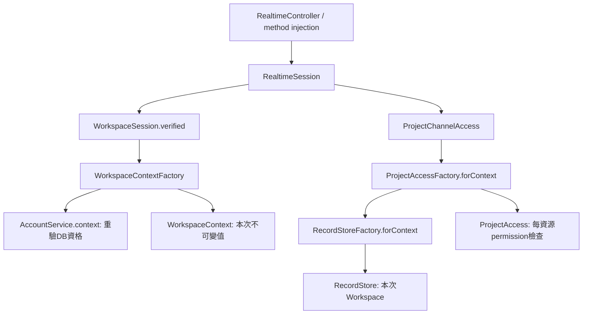

# TT-232 自有後端依賴盤點與可信Context邊界

2026-11-12。本卡完成全自有PHP盤點及可執行的Context／Store／Access Factory基礎；**不是全庫DI與PHPDoc遷移完成**。TT-233／234／235／236／249仍依各卡範圍執行。

## 逐檔清單與檢查範圍

[完整JSON](architecture/backend-dependency-inventory-2026-11-12.json)列出248個自有PHP／artisan檔案，含零出現次數的檔案。範圍包含app（Console亦含）、database／seeders／migration、tools、tests及支援類別、routes、config、bootstrap、public、docker；排除vendor、storage、node_modules、Git及bootstrap/cache生成內容。已用獨立rg檔案清單核對分母，沒有漏掉Docker初始化PHP。

| 觀測 | 數量 |
| --- | --- |
| new位置 | 351 |
| app()位置 | 40 |
| 容器make／bind／instance位置 | 9／1／1 |
| 待DI遷移人工審查位置 | 72 |
| 值／Resource／框架物件審查位置 | 155 |
| 明確Factory／Provider／啟動邊界例外候選 | 11 |
| 工具／測試fixture例外候選 | 164 |
| 自有類別顯式constructor型別邊 | 57 |

分類合計402個位置。**72是待審查位置，不是72個已確認bug；例外候選也不是一律自動批准。** 每個位置都有相對檔名、行號、種類、target與分類。純token掃描不執行原始碼、不bootstrap Laravel、不讀.env／資料庫，也不輸出字串參數或秘密。單元測試核對alias、忽略註解／字串／同名方法、空檔與constructor循環偵測。

可重跑命令（專案根目錄，image為現有後端依賴）：

```sh
docker run --rm --network none \
  --label com.docker.compose.project=tasktracker-perf-audit \
  --label com.docker.compose.service=audit \
  -v "$PWD/backend:/work:ro" --entrypoint php \
  tasktracker-backend /work/tools/audit-dependencies.php
```

產物是當日快照，不作永久零差異gate。後續變更可重跑取新清單，但不能覆寫已完成卡片／歷史狀態。掃描器在tests/Support供CLI與Unit共用，避免預設Compose未掛載最新tools而使整個測試載入失敗。

## 依賴圖與循環判讀



JSON的constructor圖目前未發現循環，這不等於完整呼叫圖已證明無循環：method injection、繼承的constructor、動態定位器、anonymous／多類別檔案與條件式factory仍須人工追。工具會列group import未解析限制；本次來源沒有這類項目，不假裝是完整PHP AST／型別分析器。

已人工追查核心現況：ApiExecution仍建立WorkspaceService；後者write一次初始化ProjectService／IssueService／TimeEntryService／ProjectBoards／ProjectMembers。IssueService另在建立含board卡片時建立ProjectBoards，ProjectBoards／各寫入Service又組裝ProjectAccess。這些是重複組裝與按需初始化問題，尚未觀察到不可終止的constructor遞迴，不能直接機械把所有類別互相constructor-inject。TT-233要先按操作拆出具體組裝，不做萬用resolve(type) Factory；TT-249再拆交易／HTTP責任。

## 可保留例外及後續處理

- DTO／查詢值（App/Data）、Resources／ApiResponse、ProjectChanged事件、DateTimeImmutable、RuntimeException／LogicException／DomainError為資料或失敗結果建構，可保留new；不把Resource視為Service依賴。不藉此批准外部IO物件。
- App/Factories中的RecordStore／ProjectAccess／WorkspaceContext／SessionLease等是帶執行期資料的明確組裝；AppServiceProvider的Session綁定、SQLite resolver及Docker／artisan bootstrap是框架邊界。Factory不註冊Actor／Workspace singleton，不接受任意類別名稱或Container當Service Locator。
- 歷史Importer的PDO及Model是明確來源／匯入工具邊界，可保留；不能複製到一般Repository或公開API。
- migration的anonymous class是Laravel慣例，不為每個migration建立DI介面。
- tests／tools的fixture、Process、反例new與Container替換可保留；不把測試new的數量當成產品違規數。
- **SMTP EsmtpTransport是外部IO，不因Symfony namespace而當普通值物件放過**：已列待遷移，TT-234需用專用Transport Factory／可替換adapter，維持verify／preview、不寄真信。
- ProjectAccess內static forRead／forUser等self組裝留作相容factory審查，不能直接判為循環或全部可保留；RecordStore／RelationalRecords／LegacyRecordStore內的協作者及歷史scope選擇仍待TT-233／234。
- ApiExecution（8處）、WorkspaceService（15處）、Todos（5處）、AccountService／WorkspaceMemberships（各4處）、IssueService及各Project／Time領域Service的穩定協作者仍待TT-233／234；DemoSeeder（9處）及匯入／升級邏輯也在清單，不能只完成HTTP核心鏈就漏掉。

## 可信Context及生命周期契約

WorkspaceContextFactory只接伺服器取得的User與Session workspace_id，沿用AccountService.context每次重驗有效Workspace資格／permission映射；WorkspaceSession.verified回傳新readonly WorkspaceContext。HTTP JSON的user、workspaceId、permissions與角色不能指定它。Context建構子是PHP內部的純值組裝，不是安全沙箱；`@internal`來源規則與實際HTTP接線才是信任邊界，**readonly／型別本身不是授權**。

Context不帶Request／Session／Model、不能直接當API Resource回傳。userId／workspaceId是明確欄位；legacyIdentity()僅為既有array用例提供副本，修改副本不改Context。這個相容橋不是新API契約，也不能讓HTTP輸入走legacyIdentity逆向建立可信資格。其他Controller閉包的型別遷移留給TT-249，未暗中改所有既有API參數。

Factory／WorkspaceSession皆Container自動解析的無租戶狀態協作者，未新增singleton／scoped binding；Context只作本次方法參數。RecordStoreFactory.forContext限定工作區，ProjectAccessFactory.forContext每次新建Access且仍require實際permission／scope／resource。Context是當次快照，不准跨交易、請求或Queue／Reverb工作保存後繞過重驗；長駐實作全面遷移仍在TT-234／236。

交易owner與SessionLease仍是ApiExecution／RealtimeSession等原邊界，Factory不自行開／提交交易。不改User→Workspace鎖、revision、requestId、RequestReplay授權、rollback／afterCommit或WebSocket私有頻道。公開Realtime設定仍只讀一般連線設定，私有authorize在原transaction內驗證Context與Project。

## 八項資料存取與驗證

- 無新API、列表／輪詢／資料表；HTTP欄位、簽章、錯誤與前端接線保持。Factory只讀本次單一資格及指定Project，不以整個Workspace作Context內容，不讀Issue全文／歷史／工時。
- WorkspaceSession原本User fresh＋AccountService資格查詢的範圍不變，Context值組裝不增加查詢。頻道路徑不再先建無scope Store再forWorkspace；測試以舊組裝作控制，限定新路徑SQL次數不得增加，且不能讀issues／time_entries／history。未拿此計數當延遲或正式容量收益。
- Container解析真正Realtime／Session入口、ProjectAccessFactory可替換、不修改產品原始碼即驗到呼叫。重用同一批Factory以A→B→A連續用例驗不同Actor／Workspace隔離；偽造HTTP身分不生效，修改legacy副本不影響原值，停用資格後同Factory重驗失敗。
- 基準RealtimeTest3／42；完整隔離memory suite **91／3893**，28個MySQL專用測試依護欄略過，未當成原生通過。
- 原生MySqlWorkspaceContextTest＋MySqlApiTest **20／548**（Context本身3／38），fixture DatabaseTransactions回滾，不改主業務庫。
- 真實Chrome＋完全獨立MySQL／背景database Queue／Reverb：雙帳號同步、無內容訊號、草稿與revision衝突、停止／重啟Reverb補抓、撤權拒絕重訂閱、CSRF與三尺寸通過。測試服務tasktracker-realtime-test，埠13024／18080，與主服務／其他Agent測試不同，完成後停止；不是mock或memory替代WebSocket。
- Pint以一次性無網路容器檢查13個本卡PHP檔案；掃描器與rg獨立核對248檔，diff／JSON與重跑一致性檢查。

未完成的全庫DI、按需初始化與PHPDoc仍明確留在TT-233／234／235／236。這些P1不因本卡Context已落地而宣稱整體架構／效能驗收通過。
