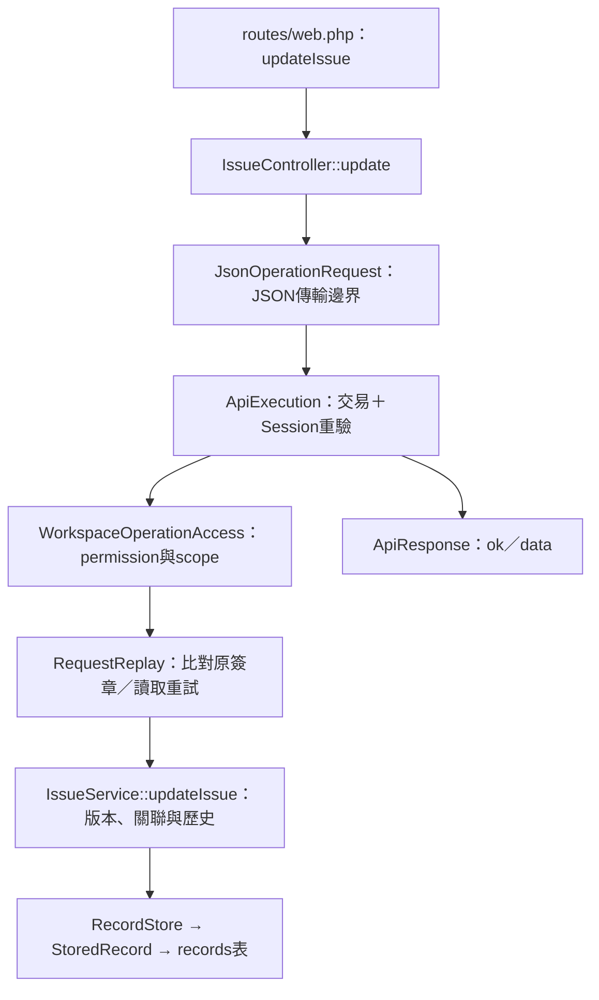

# Laravel後端程式導覽與重構紀錄

更新：2026-11-04（Asia/Taipei）。本輪重點為可讀性、責任分層及既有契約相容；對應提交`705d2b5`、`9f51ba7`、`f3cde29`。

## 從哪裡開始讀

以「修改任務」為例：

先看 [明確路由](../backend/routes/web.php)，再看對應Controller的方法；授權與重試邊界固定後，直接閱讀對應領域服務。原`ApiController`只處理未知／停用操作的相容錯誤，不再承擔所有業務。

| 位置 | 責任 |
| --- | --- |
| `Http/Controllers/*Controller.php` | 各功能HTTP入口、讀取JSON與回傳Resource；沒有SQL或業務規則 |
| `Http/Requests/JsonOperationRequest.php` | Content-Type、大小、JSON語法及物件形狀；保留原始輸入供簽章使用 |
| `Http/Resources/ApiResponse.php` | 固定成功格式`{ok:true,data:...}`，帳號操作附CSRF；沒有第二層data |
| `Services/ApiExecution.php` | HTTP應用協調：交易內重驗Session，再執行業務；帳號／Session操作也是交易內完成 |
| `Services/WorkspaceService.php` | 舊操作相容入口，明確映射操作到領域服務；供API、Seed及待辦轉卡共用 |
| `Services/WorkspaceQuery.php` | 可見專案、任務、工時、通知與成員資料的彙整 |
| `Services/ProjectService.php` | 專案資訊、責任資訊、自訂狀態與修改歷史 |
| `Services/IssueService.php` | 任務、父子／雙向關聯、留言、版本及通知預覽 |
| `Services/TimeEntryService.php` | 本人工時、每日24小時上限、工作日期及作廢 |
| `Services/Todos.php` | 自記／交辦、參與者能力、通知及原子單向轉卡 |
| `Services/ProjectBoards.php`、`ProjectMembers.php` | 看板收錄與Project授權／ACL歷史 |
| `Services/RequestReplay.php` | 共用原簽章算法與防重複提交；呼叫前必須完成當次授權 |
| `Authorization/*` | 角色映射、有效permission ID、Workspace／Project scope及作者條件 |
| `Repositories/RecordStore.php`、`Models/StoredRecord.php` | 封裝既有records表與伺服器限定namespace；不判斷角色或組合API回應 |

複雜條件改成具名判斷，主要class／function補中文docblock及參數／回傳說明。`backend/pint.json`採Laravel preset，保留規範要求的docblock標籤；沒有新增formatter依賴。

## 本輪保留的契約

- 前端RPC網址、操作名稱與DTO不變，沒有要求前端同步改REST API。
- JSON傳輸與業務欄位驗證分開：FormRequest處理傳輸；`Fields`及領域服務繼續負責allowlist、型別、狀態與關聯規則，保留錯誤碼、中文訊息與HTTP status。不是宣稱所有驗證都已移到各別FormRequest。
- AccountService／ApiExecution是與Laravel Auth／Session相接的應用邊界；Project／Issue／Time等領域服務接收重新驗證的工作空間身分，不自行讀全域HTTP Session。
- 每次操作先重新授權，再讀requestId快取；舊簽章排序及`requests`／`todoRequests` namespace保留。轉卡、關聯兩端、通知與編號仍在同一交易。
- 既有records資料、主鍵、順序及payload保留；`StoredRecord`代表此資料表，**不是已完成Project／Issue等關聯式領域模型**。完整關聯式schema需另做資料契約與遷移設計，不以本輪整理清空資料。
- 原匯入、歷史資料升級器與Seed操作契約保留，沒有順便全面改寫工具。SMTP仍只驗證、通知仍preview，Reverb仍未發布業務事件。

## 驗證

- 基準：既有30項測試／700個斷言通過。
- 第一階段：服務拆分、重試共用、具名條件及格式整理後，原30項／700斷言通過。
- 第二階段：完整34項／743斷言通過；新增`BackendArchitectureTest`，驗證舊重試簽章可讀、過期寫入可正確重播、不同payload拒絕、JSON物件邊界、未知操作、登出CSRF／null回應與StoredRecord型別／namespace／順序。
- 新測試首輪兩筆fixture誤用postJson預設陣列，實際送出`[]`；修為JSON物件後通過，未為測試放寬產品驗證。
- 完整真實API瀏覽器回歸通過：獨立容器`tasktracker-backend-refactor-api`、13024與臨時SQLite，前端不改動；包含登入／邀請、Project ACL與撤權、任務／關聯、看板、工時、通知、待辦轉卡、衝突／草稿、深連結及手機。
- 收尾將工時每日加總與待辦承辦者條件再拆成具名判斷後，完整34項／743斷言再次通過；這兩處收尾未另重跑整套瀏覽器，業務條件保持相同。
- 全部app目錄PHP語法檢查通過。
- Docker映像已完成重建，backend／queue／websocket已使用新映像；API／WebSocket與未重建的frontend／Redis均healthy，Queue為running且測試工作已消費。前端代理health、Redis連線、Queue收送及WebSocket握手檢查通過。保留舊映像標籤before-architecture-refactor供本機回退；資料volume及seed未重設。

測試在強制記憶體SQLite或無業務volume的獨立API容器執行。日誌：`/tmp/tasktracker-backend-refactor-baseline.log`、`tasktracker-backend-refactor-services.log`、`tasktracker-backend-refactor-http.log`、`tasktracker-backend-refactor-browser.log`。重建與本機服務log另在`/tmp/tasktracker-backend-refactor-build.log`、`tasktracker-backend-refactor-services-recreate.log`。暫存格式化工具未加入Git；實際格式化使用既有PHP parser與Pint，不修改共用skill來源或主機PHP。
