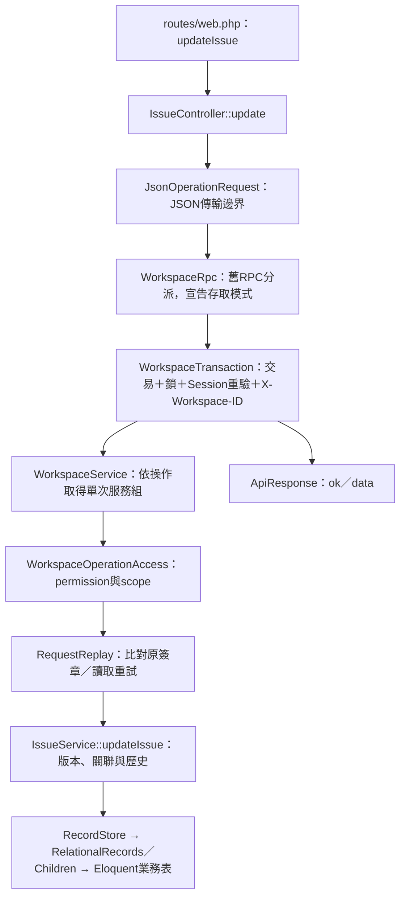

# Laravel後端程式導覽與重構紀錄

更新：2026-11-06（Asia/Taipei）。核心流程先完成可讀性／分層（`705d2b5`、`9f51ba7`、`f3cde29`），同日再依使用者要求完成關聯式儲存（`fb6e468`）。

## 從哪裡開始讀

以「修改任務」為例：

先看 [明確路由](../backend/routes/web.php)，再看對應Controller的方法；授權與重試邊界固定後，直接閱讀對應領域服務。原`ApiController`只處理未知／停用操作的相容錯誤，不再承擔所有業務。

| 位置 | 責任 |
| --- | --- |
| `Http/Controllers/*Controller.php` | 各功能HTTP入口、讀取JSON與回傳Resource；沒有SQL或業務規則 |
| `Http/Requests/JsonOperationRequest.php` | Content-Type、大小、JSON語法及物件形狀；保留原始輸入供簽章使用 |
| `Http/Resources/ApiResponse.php` | 固定成功格式`{ok:true,data:...}`，帳號操作附CSRF；沒有第二層data |
| `Http/WorkspaceTransaction.php` | 依呼叫端宣告的`WorkspaceAccessMode`（Write／Read／Unlocked）開交易；寫入先鎖User再鎖Workspace；交易內重驗Session並比對`X-Workspace-ID`，把`WorkspaceContext`交給用例。v1查詢用`read()` |
| `Http/WorkspaceRpc.php` | 舊RPC分派與工時報表；在`MODES`宣告哪些舊操作不取寫入鎖，其餘一律Write |
| `Http/AccountSessionBoundary.php` | 註冊、登入、登出、目前身分、工作區切換與邀請；交易內取鎖後才改Session |
| `Http/Session/SessionLeaseGuard.php` | 操作前後確認仍持有Session鎖租期 |
| `Services/WorkspaceService.php` | 舊操作相容入口：授權、RequestReplay、依操作取得需要的領域服務；無租戶狀態，操作者為`execute`參數 |
| `Factories/WorkspaceOperationServices.php` | 單次操作的服務組：共用一個Store與ProjectAccess，領域服務按需建立（TT-233） |
| `Services/WorkspaceQuery.php` | 可見專案、任務、工時、通知與成員資料的彙整 |
| `Services/ProjectService.php` | 專案資訊、責任資訊、自訂狀態與修改歷史 |
| `Services/IssueService.php` | 任務、父子／雙向關聯、留言、版本及通知預覽 |
| `Services/TimeEntryService.php` | 本人工時、每日24小時上限、工作日期及作廢 |
| `Services/Todos.php` | 自記／交辦、參與者能力、通知及原子單向轉卡 |
| `Services/ProjectBoards.php`、`ProjectMembers.php` | 看板收錄與Project授權／ACL歷史 |
| `Services/RequestReplay.php` | 共用原簽章算法與防重複提交；呼叫前必須完成當次授權 |
| `Authorization/*` | 角色映射、有效permission ID、Workspace／Project scope及作者條件 |
| `Repositories/RecordStore.php`、`RelationalRecords.php`、`RelationalChildren.php` | 受Workspace限制的DTO／關聯欄位及子表映射，不判斷角色或組合API回應 |
| `Models/Project.php`、`Issue.php` 等 | 明確業務欄位及Eloquent關聯；資料庫外鍵另限制同空間／專案 |
| `Repositories/LegacyRecordStore.php`、`Models/StoredRecord.php` | 僅供歷史migration、匯入staging與回退使用的records封存入口 |

複雜條件改成具名判斷，主要class／function補中文docblock及參數／回傳說明。`backend/pint.json`採Laravel preset，保留規範要求的docblock標籤；沒有新增formatter依賴。

## 本輪保留的契約

- 前端RPC網址、操作名稱與DTO不變，沒有要求前端同步改REST API。
- JSON傳輸與業務欄位驗證分開：FormRequest處理傳輸；`Fields`及領域服務繼續負責allowlist、型別、狀態與關聯規則，保留錯誤碼、中文訊息與HTTP status。不是宣稱所有驗證都已移到各別FormRequest。
- AccountService／AccountSessionBoundary／WorkspaceTransaction是與Laravel Auth／Session相接的應用邊界；Project／Issue／Time等領域服務接收重新驗證的工作空間身分，不自行讀全域HTTP Session。
- 每次操作先重新授權，再讀requestId快取；舊簽章排序及`requests`／`todoRequests` namespace保留。轉卡、關聯兩端、通知與編號仍在同一交易。
- 關聯式表保留原公開ID、順序、DTO與版本；原records不雙寫。`StoredRecord`僅代表歷史封存，Project／Issue等另有Eloquent模型。主鍵／外鍵及快照JSON邊界見[關聯式資料設計](database-design.md)。
- 原匯入、歷史資料升級器與Seed操作契約保留，沒有順便全面改寫工具。SMTP仍只驗證、通知仍preview，Reverb仍未發布業務事件。

## 驗證

- 基準：既有30項測試／700個斷言通過。
- 第一階段：服務拆分、重試共用、具名條件及格式整理後，原30項／700斷言通過。
- 第二階段：完整34項／743斷言通過；新增`BackendArchitectureTest`，驗證舊重試簽章可讀、過期寫入可正確重播、不同payload拒絕、JSON物件邊界、未知操作、登出CSRF／null回應與StoredRecord型別／namespace／順序。
- 新測試首輪兩筆fixture誤用postJson預設陣列，實際送出`[]`；修為JSON物件後通過，未為測試放寬產品驗證。
- 完整真實API瀏覽器回歸通過：獨立容器`tasktracker-backend-refactor-api`、13024與臨時SQLite，前端不改動；包含登入／邀請、Project ACL與撤權、任務／關聯、看板、工時、通知、待辦轉卡、衝突／草稿、深連結及手機。
- 收尾將工時每日加總與待辦承辦者條件再拆成具名判斷後，完整34項／743斷言再次通過；這兩處收尾未另重跑整套瀏覽器，業務條件保持相同。
- 全部app目錄PHP語法檢查通過。
- Docker映像已完成重建，backend／queue／websocket已使用新映像；API／WebSocket與未重建的frontend／Redis均healthy，Queue為running且測試工作已消費。前端代理health、Redis連線、Queue收送及WebSocket握手檢查通過。保留舊映像標籤before-architecture-refactor供本機回退；資料volume及seed未重設。

測試在強制記憶體SQLite或無業務volume的獨立API容器執行。日誌：`/tmp/tasktracker-backend-refactor-baseline.log`、`tasktracker-backend-refactor-services.log`、`tasktracker-backend-refactor-http.log`、`tasktracker-backend-refactor-browser.log`。重建與本機服務log另在`/tmp/tasktracker-backend-refactor-build.log`、`tasktracker-backend-refactor-services-recreate.log`。暫存格式化工具未加入Git；實際格式化使用既有PHP parser與Pint，不修改共用skill來源或主機PHP。

## 關聯儲存追加驗收

同日使用者要求將集中 payload 改為關聯式表。新增22張表、Eloquent關聯、複合外鍵與索引，正常業務改寫入欄位／子表；Seed局部重設及舊Node匯入同步適配。既有歷史migration仍可處理舊records，回退先匯出最新關聯資料。

完整38項／796斷言、隔離真實瀏覽器回歸通過；本機備份副本逐欄比對69筆舊資料通過。實際升級／資料完整性與剩餘邊界見[資料設計驗收](database-design.md#本輪驗證)。上方34項驗證屬前階段分層紀錄，並非最新儲存架構的全部驗收。

2026-11-06架構重構階段一：HTTP交易／Session協調移入`Http/ApiExecution`及`Http/WorkspaceSession`，AccountService接受可信User及工作區ID，註冊／登入回`AuthenticatedAccountData`，不接Request／Auth facade；RealtimeController經`Http/RealtimeSession`協調，ProjectChannelAccess獨立驗證私有頻道及permission。原Session blocking、CSRF、交易及回應契約不變。完整59項及新增非HTTP帳號測試通過；後續範圍見plans/main。

2026-11-06階段二：工時分析增加專用TimeReportRequest、readonly TimeReportData／TimeReportEntryData及Eloquent TimeReportRepository，HTTP用例只傳DTO，Repository先按工作區／已授權專案／日期／成員查詢，不讀全歷史或整個卡片集合。WorkspaceTimeReport仍負責permission、聚合與輸出投影，ApiResponse保持原契約；現有非HTTP入口array僅相容轉DTO，不作為新功能預設。SQL群組聚合／分頁不在此次範圍。

完整前後端重構成果、閱讀入口及未遷移的相容邊界見[重構紀錄](refactoring-2026-11-06.md)。

## 2026-11-12 可信Context與組裝入口

WorkspaceSession.verified → WorkspaceContextFactory → AccountService重新驗證後回readonly WorkspaceContext；舊context()以legacyIdentity()保持array契約。RealtimeSession／ProjectChannelAccess已用Context方法參數，經ProjectAccessFactory／RecordStoreFactory組裝本次scope，其他用例逐卡遷移，不把Context存為singleton。全自有PHP盤點、依賴圖、例外及驗證見[TT-232報告](backend-context-boundaries-2026-11-12.md)。

## 2026-11-12 拆分ApiExecution（TT-249）

原`ApiExecution`同時負責帳號／Session操作、舊RPC分派、工時報表與v1查詢，且在內部寫死唯讀操作清單。現在拆成`AccountSessionBoundary`、`WorkspaceTransaction`、`WorkspaceRpc`與`SessionLeaseGuard`：

- Controller一眼可讀：查詢寫成`$workspace->read($request, fn (WorkspaceContext $context) => ...)`；舊RPC寫成`$rpc->execute(...)`；帳號寫成`$accounts->handle(...)`。
- 讀取服務改收型別化的`WorkspaceContext`（`userId`、`workspaceId`、`permissions`、`role`），不再以`$actor`指稱整包array；仍需array的舊協作者明確呼叫`legacyIdentity()`。
- 三種模式與原本行為逐一對應：
  - 原「不取鎖＋SQLite唯讀交易」的query／getWorkspace／getTimeReport為`Read`。
  - 原「不取鎖、一般交易」的getTodos／getProfile／getProjectMembers／smtpStatus／verifySmtp為`Unlocked`。
  - 其餘為`Write`。
  - `getWorkspace`仍不比對`X-Workspace-ID`。
- API路由、ok/data envelope、DomainError與DTO不變。
