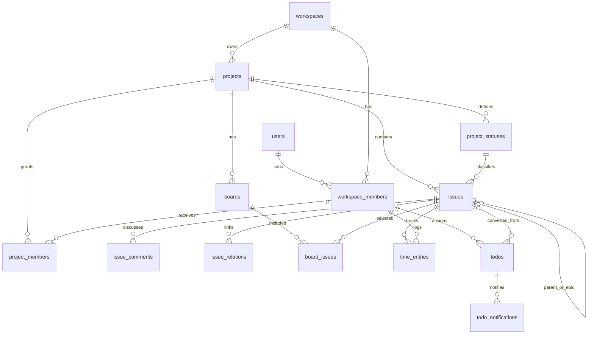

# TaskTracker 關聯式資料設計

更新：2026-11-04（Asia/Taipei）。使用者要求以正常關聯式資料儲存取代原型的 `records.payload`。目前資料庫保留 SQLite，API／前端 DTO 保留；不是以清空資料換架構。

## 主要關聯

Epic／Task／Bug 共用 `issues`；`epic_id` 與 `parent_issue_id` 是不同關聯。看板不複製任務，Default 直接查目前 Project 全部任務，自訂看板只存明確收錄的 pivot；Epic 動態展開仍由領域服務負責。

## 資料表

本次新增 **22 張**表，既有 `users`、Session、Cache、Queue 等 Laravel 表繼續使用。

| 範圍 | 資料表 | 內容 |
| --- | --- | --- |
| 帳號／空間 | `users`、`workspaces`、`workspace_members` | 帳號資料及密碼、工作空間、加入時間／空間角色／停用時間 |
| 邀請 | `workspace_invitations` | 邀請識別碼、目標 Email、空間、到期與使用時間 |
| 專案 | `projects` | 代碼、名稱、介紹、負責人、下個卡片編號、revision |
| 狀態 | `project_statuses` | 專案內穩定 code、名稱、category、顏色、排序 |
| Project ACL | `project_members`、`project_access_controls` | 成員的角色映射、撤回時間、成員／整體授權版本 |
| 卡片 | `issues` | 標題、內容、類型、狀態、負責人、期限、估時、Epic／父任務、revision |
| 留言／關聯 | `issue_comments`、`issue_relations` | 留言內容／作者快照、同專案卡片關聯與排序 |
| 看板 | `boards`、`board_issues` | 看板資訊／封存、明確收錄的卡片與排序 |
| 工時 | `time_entries` | 任務、填報人、工作日、整數分鐘、說明、revision／作廢時間 |
| 通知預覽 | `issue_notifications` | 卡片／收件人、Email／標題／內文快照及 preview 狀態 |
| 小待辦 | `todos`、`todo_notifications` | 建立者、交辦對象、原交辦對象、狀態、轉卡目標及通知／已讀時間 |
| 異動歷史 | `audit_events` | 工作空間、實體種類／內部 ID、歷史 stream、順序、事件快照 |
| 防重複提交 | `operation_receipts`、`todo_operation_receipts` | 原操作者＋requestId、簽章、已完成操作的結果快照 |
| 升級／示範資料 | `workspace_upgrades`、`demo_seed_states` | 已套用的升級及示範 namespace 版本 |
| 停用功能封存 | `retired_saved_views` | 保留舊視圖資料，不恢復畫面或 API |
| 原型歷史封存 | `records` | 升級前原始 JSON，正常業務不讀寫；歷史 migration、匯入 staging 與回退使用 |

角色仍是程式內權限組合，成員表儲存映射 ID；沒有新增自訂角色／權限編輯功能。ACL 以有效 permission＋scope＋資源條件判斷，Eloquent 關聯或外鍵不代表取得讀取權。

## 主鍵、約束與查詢

- 新表用數字 `id` 作內部主鍵／外鍵，原公開 ID 放 `public_id`；`users.id` 維持既有字串。成員以 `user_id` 對應帳號。公開 ID、卡片編號、revision、日期、異動內容與重試簽章保留。
- 公開 ID 在 Workspace 內唯一；Workspace、邀請與 Seed 標記的公開 ID 全域唯一。專案代碼在同空間唯一，卡片編號在同專案唯一。
- 子表帶 `workspace_id`，卡片與專案相關外鍵再包含 `project_id`。資料庫直接拒絕跨空間負責人、跨專案狀態／父子／Epic／工時／看板收錄／關聯。
- 成員、專案、任務等父資料使用 `RESTRICT`，不因刪帳號／專案而連帶刪歷史；成員撤權／工時作廢／看板移除沿用既有軟停用語意。留言、看板 pivot 只有在父資料確實移除時才 cascade。
- 同 Project／Member 只能一筆資格，同 Board／Issue 及有向 Issue／RelatedIssue 不能重複。雙向關聯由服務在同交易同步兩端，保留雙方 revision／歷史。
- 索引包含租戶＋公開 ID、專案代碼、卡片編號、任務負責人／狀態、工時填報人／工作日及待辦指派人／狀態。
- `issues.storage_position` 保留原始插入順序；遷移時先建立 Epic／父項再建子項，不因此打亂 DTO 順序。它與使用者看板排序無關。
- 外鍵保證參照完整性；一層子任務、類型語意、每日工時上限、permission、revision 與防重複提交仍由同交易內的領域規則驗證。

## 程式入口與 JSON 邊界

- [業務 migration](../backend/database/migrations/2026_11_04_000000_create_relational_business_tables.php)：實際欄位、外鍵、索引及回填。
- `app/Models/Project.php`、`Issue.php`、`Board.php` 等：Eloquent `belongsTo`／`hasMany`／`belongsToMany` 關聯，可直接查詢業務欄位。
- `RecordStore` 保留既有服務 DTO 入口，正常模式轉給 `RelationalRecords`／`RelationalChildren`；欄位映射集中在 `EntityDefinitions`。不再把完整卡片序列化進單一 payload。
- `LegacyRecordStore` 僅供升級前 schema、匯入與回退。原匯入仍要求空目標，來源唯讀；正常 API 不向 `records` 雙寫。
- 事件前後值、重試結果及通知文字本來就是快照，保留 JSON／文字。`legacy_attributes` 只保存未映射的歷史擴充欄位；核心欄位、留言、狀態與關聯各自存放，不把新增業務欄位塞進此相容欄位。
- `audit_events` 是帶 Workspace 邊界的多型歷史表；實體關聯不由 SQL 多表外鍵強制，服務負責同步。正常查詢批次載入留言／關聯／歷史，避免逐卡片查詢。

這一輪完成儲存正規化；領域服務仍使用現有 DTO／RecordStore 入口。後續若整理 entity-specific 查詢、分頁或 Resource，可逐案進行，不把本輪說成整個 API 已全面改為 REST／純 Eloquent domain。

## 升級與回退

1. 停止業務寫入，先用 SQLite online backup 或 `VACUUM INTO` 備份（包含 WAL 狀態），不要只複製正在使用的主檔。
2. 用備份副本在隔離容器跑 `php artisan migrate --force`，比對原欄位、筆數、帳號、revision／歷史，以及 `PRAGMA foreign_key_check`／`integrity_check`。
3. 預演通過才對原資料庫 migrate，重啟 queue／websocket。不需 reset Seed，也不修改原帳密。
4. 新 migration 依 Workspace→Member→Project／Status→Issue→子集合回填，無效參照會整批失敗。只有缺少舊卡片編號時，才補穩定的「Project代碼＋原公開ID」，不更換公開 ID。
5. 回退時，`down()` 先把**目前最新**關聯資料匯回舊 records，再移除新表；不只恢復升級前快照。回退也應先備份並停寫。舊程式需能理解當時的 DTO；不建議直接跳過多個版本回退。

目前只驗證 SQLite／PHP 8.5.12，沒有宣稱 MySQL／PostgreSQL 相容已驗收。正式多人 SaaS 的資料庫選型、備份保留與大資料量分頁另行設計。

## 本輪驗證

- 38 項 Laravel 測試／796 個斷言通過，使用強制隔離的記憶體 SQLite。新增關聯讀取、FK 拒絕越界、回填／回退／再升級、舊快取沒有 payload.id、失敗回滾及查詢數上限。
- 真實瀏覽器全流程回歸通過：獨立 13024 API、臨時 SQLite／假帳號，涵蓋 ACL／撤權、列表／看板／任務、工時、待辦／通知／轉卡、版本衝突與手機。未用業務資料庫做測試。
- 本機備份副本預演：逐欄比對 69 筆原紀錄；1 Workspace、5 Member、2 Project、14 Issue、6 TimeEntry，以及 ACL、升級、舊視圖與重試結果全部保留。原 records 與帳號雜湊一致，外鍵及 integrity check 通過。
- 本機套用結果：待最終升級後記錄。

測試與預演日誌在 `/tmp/tasktracker-relational-{tests,browser,preview}.log`，不提交資料庫、備份、截圖或產物。
