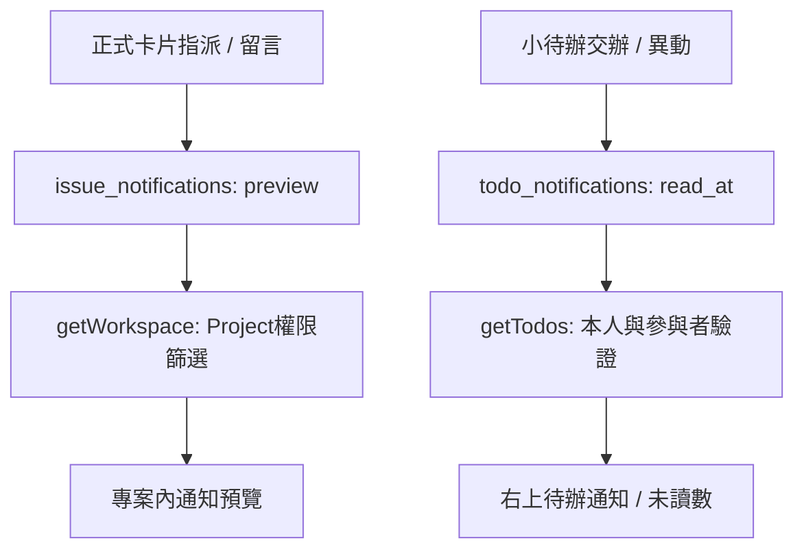

# 指派、留言與mention通知盤點

日期：2026-11-11。範圍：讀取現有程式與執行既有隔離測試，沒有實作新通知功能。

## 結論

目前有兩套分開的機制：**正式Issue只有待寄通知預覽；小待辦才有右上角可讀／未讀的站內通知。** 兩者沒有合併。Issue雖然有儲存通知資料，不能解讀為已主動提醒收件人，更沒有真的寄Email。**目前沒有@mention功能。**

## 正式卡片觸發矩陣

下表為IssueService及查詢／畫面原始碼確認的現況，不是後續規格：

| 操作 | 對象 | 目前結果 |
| --- | --- | --- |
| 建立卡片並指派B | B有權讀卡，且B不是操作者 | 建一筆`preview`，在該專案「通知預覽」查看；不進右上鈴鐺、不寄信 |
| 將原本A負責的卡改派B | 新負責人B | 對B建預覽；不額外通知原負責人A；原有預覽不是自動刪除的動態收件匣 |
| 指派自己／改派自己 | 自己 | 不建立通知預覽 |
| 取消指派 | 無負責人 | 不建新通知，也不通知原負責人 |
| 別人在B負責的卡留言 | 目前負責人B | 對B建「新留言」預覽，內容含留言與卡片標題 |
| B在自己負責的卡留言 | 自己 | 不通知自己 |
| 無人負責的卡被留言 | 無 | 不通知其他人；沒有自動通知建立者／所有留言者／追蹤者的機制 |
| 留言寫`@C`，C不是負責人 | C | 沒有mention解析／通知；若有另一位負責人B，仍只走一般留言的B預覽 |
| 描述寫`@C` | C | 純文字／Markdown，不建立mention通知 |
| 一般狀態、標題、優先級、期限改動 | 負責人 | 沒有一般異動通知；若同次改派，仍會通知新指派對象 |
| 已closed的Epic底下，未closed卡片被更新 | Epic負責人，且非操作者 | 另建「Epic需要重新確認」預覽；不限於重開，也可能是未結案卡的其他欄位修改；不是自動重開Epic |

收件人必須是有效成員且有`issue.read`，不以被指派／被提及就授予專案存取權。`WorkspaceQuery::visibleNotifications`先限制目前可見Issue，再允許本人收件資料，或有`notification.readTeam`者看該專案團隊預覽；管理者可閱覽團隊預覽，不代表他自動成為每張卡的通知收件人。撤權後查詢不再回傳不可見卡的舊通知，儲存紀錄可保留。

## 小待辦機制

- 交辦給其他有效成員，產生`assigned`站內通知；自己速記不通知自己。
- 編輯、完成、重開、退回、取消、轉卡等合法操作，通知另一位參與者：交辦者操作時通知承辦者，承辦者操作時通知交辦者；自辦自做不產生自我通知。
- `todo_notifications`有`read_at`，右上角「待辦通知」及未讀數只來自`getTodos`的本人通知。點擊時呼叫`readTodoNotification`，標已讀後導回首頁待辦。
- 資料只對參與者開放；即使Owner也不能隨意看別人的私人待辦或替他標已讀。對象被停用／無有效待辦權限時不產生新提醒。
- 小待辦沒有留言或mention模型；轉正式卡後依Issue規則操作，不自動把Issue通知接回待辦鈴鐺。

## 傳遞與畫面入口



- `issue_notifications`沒有已讀欄位，現有API沒有正式Issue標已讀／未讀數接口。`NotificationPreview.vue`明示「尚未寄送／待寄預覽」。它是一個可查詢的專案頁，沒有個人鈴鐺提示。
- `SmtpService::status`明確回`mode=preview`、`canSend=false`；verify只做TLS連線與認證，不寄信。沒有把通知資料交給真實寄送Job的流程。
- Reverb的`ProjectChanged`只送`changed=true`，讓看板重抓資料；它不是對收件人的個人通知推播。沒有瀏覽器Web Push／桌面通知實作。
- `useWorkspaceClock`目前每30秒在已登入、未切區時觸發refresh，`refreshWorkspace`先取Workspace再取Todo。沒有完整visibility／offline控制；瀏覽器背景節流也使它不能保證準時提醒。看板事件可觸發重抓，但不能因此稱所有頁面的個人通知即時。
- 尚無統一通知中心、Issue已讀狀態、追蹤者／訂閱、通知偏好／摘要或mention候選選單。

## 後續建議（未實作，需確認範圍）

1. **先把Issue通知做成真正的站內收件匣。** 統一右上入口或清楚分類Issue／Todo，提供本人未讀數、標已讀、點擊進卡及撤權後清除；保留管理者的團隊閱覽能力與個人收件資格分離。沿用既有事件，Email可後做。
2. **補留言@mention。** 從有權讀該卡的成員中選人，以穩定User ID儲存引用，不靠顯示名稱字串推斷；同名、改名、Markdown code／Email及無權對象要有明確處理。先做留言；描述／待辦是否可mention另定。
3. **收件人去重與去噪。** 預設通知指派對象、卡片負責人與明確提及者；操作者不通知自己，負責人同時被@時同一事件只提醒一次。不要預設通知所有專案成員或所有曾留言者；追蹤／訂閱為後續選配。
4. **共用業務事件與權限。** Web與未來PAT／REST寫入產生相同通知；不為AI另造通知流程。事件持久化、requestId重送、已讀及去重語意、撤權後查詢／投遞均要驗收；若未來寄信，另補可靠出站與退訂／偏好。

使用者本輪要求是盤點，並提出「若沒有@，之後可能補」；不視為已核准直接開發完整收件匣、mention或Email。建議補回TT-190，SMTP仍由TT-189另外追蹤，均維持暫緩／待確認。TT-204只追蹤本輪審查，完成報告後結案。

## 證據與驗證

| 路徑 | 核對內容 |
| --- | --- |
| [IssueService](../backend/app/Services/IssueService.php) | createIssue、updateIssue、addComment、notify的觸發／收件人／preview |
| [WorkspaceQuery](../backend/app/Services/WorkspaceQuery.php)／[ProjectAccess](../backend/app/Authorization/ProjectAccess.php) | 可見Issue、本人／團隊通知與有效成員資格 |
| [EntityDefinitions](../backend/app/Repositories/EntityDefinitions.php) | Issue預覽與Todo readAt欄位不同 |
| [Todos](../backend/app/Services/Todos.php) | assigned／異動通知對象、readTodoNotification與參與者限制 |
| [App](../frontend/src/App.vue)／[TodoNotifications](../frontend/src/components/TodoNotifications.vue) | 鈴鐺僅讀Todo、點擊已讀流程 |
| [NotificationPreview](../frontend/src/components/NotificationPreview.vue)／[SmtpService](../backend/app/Services/SmtpService.php) | 待寄預覽入口、verify不寄送 |
| [useWorkspaceClock](../frontend/src/composables/useWorkspaceClock.js)／[boardRealtime](../frontend/src/ui/boardRealtime.js)／[ProjectChanged](../backend/app/Events/ProjectChanged.php) | 輪詢與僅有看板變動訊號 |
| [MarkdownEditor](../frontend/src/components/MarkdownEditor.vue)／backend/app與frontend/src搜尋 | 沒有mention識別／候選／收件人流程；沒有watcher／subscriber／reporter模型流程 |

執行既有回歸：

```sh
docker compose exec -T backend php artisan test --do-not-cache-result --filter='TodoTest|test_relations_assignments_notifications_and_time_are_limited_to_the_project|test_markdown_description_and_comments_preserve_whitespace'
```

結果：**11 tests、202 assertions通過**，涵蓋Todo通知／已讀／防重送／參與者隔離／撤權、Issue專案範圍的指派與通知可見性及留言Markdown保存。TestCase在bootstrap前強制memory SQLite及array Session／Cache、sync Queue、null Broadcast；測試不讀寫主MySQL，不發真實Email／WebSocket。

限制：矩陣中的留言收件人、自我抑制及無mention等細節以現行程式路徑確認；既有測試不是完整逐格通知測試。本輪沒有新增產品測試或真人雙瀏覽器投遞／Email測試，沒有將「預覽列存在」當成實際送達。未修改產品程式或部署，只新增審查文件與授權的Tracker交接資料。
