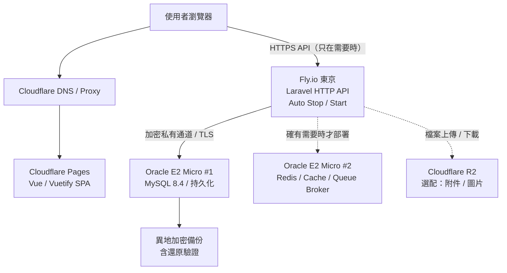

# TaskTracker 低成本部署與同步重構計畫

> 狀態：規劃／待 Codex 盤點與實作  
> 版本：v1.0  
> 日期：2026-11-11  
> 專案：https://github.com/joshting-developer/TaskTracker

## 0. 核心決策（先看這裡）

現階段 TaskTracker 使用人數極少，優先完成產品功能、穩定性與正式部署，不為尚未出現的高併發需求維護額外常駐服務。

1. **暫停使用 Laravel Reverb / WebSocket 即時同步**，但保留日後重新引入即時推播的架構彈性。
2. **前端改用智慧輪詢（Smart Polling）**：只在頁面可見且登入有效時，定期檢查是否有更新；看板約 30 秒、通知約 60 秒，實際間隔應可配置。
3. **後端以 Laravel + MySQL 為主**。專案目前 README 已記載 MySQL 8.4 LTS／InnoDB，**先核對既有切換成果，不要重新做一遍 SQLite → MySQL 遷移或重設資料**。
4. **Fly.io 只承載可隨流量啟停的 Laravel HTTP API**，盡量避免常駐 Queue Worker、Scheduler、WebSocket 服務。
5. **Oracle Cloud Always Free E2 Micro 承載需要持久化的服務**：優先 MySQL；Redis 如確有需要，才放第二台 Micro。兩台各 1 GB RAM，不可視為一台 2 GB VM。
6. **Cloudflare Pages 承載 Vue 靜態前端**；R2 作為未來附件／圖片的候選物件儲存，非第一階段必要條件。
7. **跨 Fly.io ↔ Oracle 的資料庫／Redis 連線必須加密、經過驗證與限制來源**；不得直接對公網開放 3306 或 6379。
8. **目標是低且可預測的成本，而非絕對零成本**。以每月 NT$500 左右作為上限參考，按實際用量及 Fly.io 最新價格驗證。若跨雲架構維護成本高或無法穩定，保留回退單台 VPS 的選項。

---

## 1. 專案現況（實作前再次查證）

依 2026-11-11 查閱 GitHub `main` 分支 README：

| 區塊 | 現況／預期 |
|---|---|
| 前端 | Vue 3 + Vuetify 4 + Vite，獨立 SPA |
| 後端 | Laravel 13 JSON API；Docker 使用 PHP 8.5 |
| 資料庫 | README 已記載 MySQL 8.4 LTS / InnoDB；保留原 SQLite 匯入／回退資料 |
| Redis | 目前提供 Queue / Cache，Compose 設定 AOF 持久化 |
| Queue | Laravel Redis Queue Worker，目前在 Docker Compose 中獨立服務 |
| Reverb | 目前看板使用私有 Project 頻道進行即時同步 |
| 同步備援 | README 已記載看板有 30 秒輪詢備援，以及重連後補抓資料 |
| 通知 | 站內通知已有資料庫儲存與輪詢行為 |
| 本機環境 | `docker-compose.yml` 包含 frontend / backend / queue / websocket / redis / mysql 等服務 |

**Codex 必須先以實際程式碼為準進行盤點**。README 可能比部分部署檔或環境設定更新，不能直接推定所有路徑都已完成 MySQL 切換。

參考文件：
- Repository README：https://github.com/joshting-developer/TaskTracker
- Docker Compose：https://github.com/joshting-developer/TaskTracker/blob/main/docker-compose.yml
- 環境變數範例：https://github.com/joshting-developer/TaskTracker/blob/main/.env.example
- Repository `docs/` 中的 MySQL 切換紀錄、看板即時同步、權限契約與相關測試

---

## 2. 目標部署架構



### 2.1 服務部署分工

| 服務 | 目標平台 | 是否常駐 | 備註 |
|---|---|---|---|
| Vue 前端 SPA | Cloudflare Pages | 靜態託管 | 不使用開發版 Vite Server |
| Laravel HTTP API | Fly.io 東京 `nrt` | **按流量啟停** | 無資料持久化依賴於 Machine 本地檔案系統 |
| MySQL 8.4 | Oracle E2 Micro #1（東京） | 是 | 1 GB RAM、調校 MySQL 記憶體；外部備份 |
| Redis | Oracle E2 Micro #2（東京）**選配** | 是 | 確認 Queue / Cache / Session 需求後再決定 |
| Laravel Reverb | **暫停部署** | 否 | 先移除 WebSocket 的執行依賴 |
| Queue Worker | 待盤點 | 原則上避免全天常駐 | 不可直接停用而讓 Queue Job 永遠不執行 |
| Scheduler | 待盤點 | 視排程需求 | 用專用定時觸發方案，不讓 Web API 因排程常駐 |
| 上傳檔案 | Cloudflare R2（後續選配） | 雲端物件儲存 | Laravel Storage S3 driver 整合 |

### 2.2 Oracle 容量限制與磁碟規劃

- Always Free 的 `VM.Standard.E2.1.Micro` **最多兩台**，每台 **1 GB RAM**、基準約 **1/8 OCPU**，不可將兩台 RAM 合併。
- Always Free 的 Boot Volume + Block Volume **帳戶合計 200 GB**，包含兩台 VM 的開機磁碟；必須確認沒有其他仍存在的磁碟占額度。
- 第一版可先採 **MySQL VM：50 GB Boot + 100 GB Data Volume**；第二台 Redis VM：50 GB Boot。這是可選配置，不代表必須配置滿額度。
- 建議資料庫使用獨立資料磁碟，並且另做應用層一致性備份。**Volume ≠ Backup**；本機備份也不能代替異地備份。
- Redis 不需要 50 GB 的資料容量才運作；此處第二台 50 GB 主要是 Oracle VM 預設開機磁碟配置。
- 留意 Oracle 免費 VM 有閒置回收風險；保持可重建能力與可靠異地備份，不以製造假負載規避限制。

### 2.3 Redis 是否真的需要：先盤點再決定

首選優先順序：

1. **只用 MySQL**（若低流量下可支援 DB Session / DB Cache / Database Queue，且沒有即時性需求）。
2. **MySQL + Redis**（若確實需要 Redis Cache、Session、鎖、Queue Broker，或有負載證據）。
3. 若 E2 Micro 效能不足，再評估單台較大 VPS，而不是無限制增加跨雲複雜度。

切換前確認 Queue jobs、延遲工作、Broadcasting、Session、Rate Limiting 與 Cache Lock 各自用的 driver。**Database Queue 依然需要執行 Job 的 Worker**，不能僅改 driver 就認為已解決背景工作。

---

## 3. 功能改造：Reverb → Smart Polling

### 3.1 目標行為

| 使用場景 | 建議同步方式 |
|---|---|
| 使用者拖曳自己的卡片 | Optimistic UI 立即更新，HTTP API 寫入，失敗時回滾／提示 |
| 其他人更新同一看板 | 進入看板時載入，之後**約 30 秒**檢查版本 |
| 未讀通知 | 登入且頁面可見時**約 60 秒**查詢 |
| 瀏覽器分頁從背景回到前景 | 立刻重新檢查（加上最短間隔與請求去重） |
| 分頁隱藏／瀏覽器離線／使用者登出 | **停止輪詢** |
| 進入任務詳細頁或切換看板 | 視需要立即查詢，僅輪詢相關資源 |
| 網路異常／5xx／429 | 指數退避，避免重試風暴 |

**注意**：30 秒輪詢並非完全不影響 Fly.io 帳單。只要頁面保持可見，持續每 30 秒發送 HTTP 請求，就可能讓 Machine 一直保持活躍。因此「看板無使用者時」才有最理想的休眠效果。預設間隔要可配置並在真實用量下調整；可考慮未互動時逐步延長到 60–120 秒。

### 3.2 輪詢實作要求

- 以單一可重用 Polling Manager / composable 管理，不要每個 Vue 元件各自建立多個 `setInterval`。
- 使用 `document.visibilityState`、`online/offline`、焦點恢復事件；卸載頁面與登出時清理 timer / AbortController。
- **防止重疊請求**：上一輪未結束時不再開下一輪；使用 timeout、AbortController 與 backoff。
- 加入少量 **jitter**，避免多個使用者同時每 30 秒打到 API。
- 支援 API 401、403 處理：過期登入停止輪詢；權限撤銷應立刻清除不該再看的資料。
- 使用者正在拖曳／編輯、草稿未送出時，不可因輪詢粗暴覆蓋尚未保存的前端狀態。
- 避免全量刷新：優先取得 revision / updated_at / unread count 等輕量資料，版本改變才拉取清單或詳細內容。
- 所有輪詢端點必須沿用現有 Workspace / Project 權限檢查及 rate limiting；不得讓未授權者探測資源是否更新。
- 可利用 TanStack Query 或既有資料層實作，但**先沿用專案現有技術與模式**，不要為輪詢強行引入大型新依賴。

### 3.3 API 設計（建議，不得在未盤點前直接新增重複端點）

先檢查是否已有通知 API、看板版本欄位／revision 與輪詢機制。若沒有適合的輕量檢查端點，再考慮：

```http
GET /api/sync?project_id=123&board_id=456&board_revision=87
Authorization: Bearer <token>
```

回應範例：

```json
{
  "board_changed": false,
  "board_revision": 87,
  "unread_notification_count": 2,
  "server_time": "2026-11-11T07:00:00Z"
}
```

原則：

- 僅回傳該使用者有權存取的資料。
- 有變動才重新取得相關 Board / Issue，避免每次都傳完整看板。
- `revision` 必須有明確可靠的更新語意，不可僅用容易同秒衝突的時間字串當絕對版本。
- 若現有 API 已支援 `ETag` / `If-None-Match`，可沿用標準 HTTP 快取語意；私人資料不得錯誤地被公用 CDN 快取。
- 這是**最終一致性（eventual consistency）**。多人同時拖曳時仍須沿用既有 revision / requestId / conflict handling，出現衝突應用 409 或既有契約處理，而不是最後寫入者直接靜默蓋掉。

### 3.4 Reverb 移除／停用的邊界

- 盤點並移除 **正式部署** 所需的 `websocket` container、Reverb 啟動命令、外部 WebSocket Port、前端 Echo / Pusher 連線初始化。
- 對 Reverb 專用環境變數、Broadcast driver、Queue 設定做清理；**避免移除後 Laravel 還嘗試發送 Broadcasting Job**。
- **保留業務事件的概念與重要歷史／稽核紀錄**，不要把 `TaskMoved` / `IssueUpdated` 之類的 Domain Event 與權限邏輯一起刪掉。
- 如果業務事件目前直接實作 `ShouldBroadcast`，應先分析是否仍被其他程式碼依賴，再選擇改成純 Domain Event、停用 broadcast 或保留可切換 adapter。
- 讓未來重新加入 Reverb 時，不必重新設計資料庫與整個前端狀態管理。
- 已有 30 秒輪詢備援時，**優先抽取、完善既有程式**，避免重寫第二套功能。

---

## 4. Laravel 與 Fly.io 部署策略

### 4.1 Fly.io HTTP Machine

目標：一個不保存重要本地狀態的 Laravel Web Machine，部署於東京 `nrt`，無流量時允許停止。

`fly.toml` 概念設定（`internal_port` 依最終 production image 監聽值調整）：

```toml
primary_region = "nrt"

[http_service]
  internal_port = 8080
  force_https = true
  auto_stop_machines = "stop"
  auto_start_machines = true
  min_machines_running = 0
```

上述只是設計範本，不可直接假定目前 Laravel 容器已在 8080 埠提供正式 HTTP 服務；**由 Codex 對應 Web Server（如 Nginx + PHP-FPM / FrankenPHP）決定**。Fly.io 的 auto-stop 依代理連線與負載判斷，不保證固定幾秒立即停機。

### 4.2 無狀態化要求

- `APP_ENV=production`、`APP_DEBUG=false`、`APP_KEY` 以安全 Secret 管理；不得進入 Git。
- PHP Session、Cache、Queue 不得依賴 Fly Machine 的可丟棄本地磁碟；依盤點決定 MySQL / Redis driver。
- 使用者附件、業務檔案不能只儲存在 Fly Machine 的本地 `storage/`；上傳應導向物件儲存或有明確持久化方案。
- 避免每次啟動都執行有風險的 migration / seed；migration 應在部署流程中控管，具備備份及失敗回退。
- Composer / 前端 build 應在 CI / Docker image 建置階段完成，Machine 啟動後只負責執行。
- 設定 health check，但不要讓外部每分鐘 Ping 持續喚醒 Machine，抵消 auto-stop 省費效果。
- 測試冷啟動第一次 API 的等待時間、資料庫重連、短暫失敗重試與從 0 台運作中 Machine 正常喚醒。

### 4.3 Queue / Scheduler 的必做決策

Codex 必須先搜尋所有 `dispatch()`、`ShouldQueue`、`ShouldBroadcast`、Notifications、mail、排程與任何 `queue:work` 設定，建立清單並分類：

1. **同步且低耗時**：可改同步處理，但需設 timeout、錯誤處理，不得把可能阻塞的工作強塞進請求。
2. **必要非同步工作**：保留可靠的 worker 方案，明確說明啟動機制及費用；有 Job 不代表 Fly 的 Web Machine 會被喚醒。
3. **定時工作**：使用定時觸發平台或可短暫啟動的獨立程序，不依賴 Web Traffic。
4. **不再需要的 Broadcasting Job**：可停用或改造，避免堆在 Redis 裡無人消費。

在必要非同步工作有方案以前，**不可以直接刪掉 Queue Worker 並宣稱部署完成**。

---

## 5. Oracle MySQL / Redis 與跨雲網路安全

### 5.1 Oracle Micro 資源調校

MySQL VM RAM 只有 1 GB，需盤點並調整 `innodb_buffer_pool_size`、`max_connections`、暫存／sort buffer、Performance Schema 等實際記憶體使用，依 MySQL 8.4 支援的參數與監測數據決定；**不要直接套用不明版本的調校模板**。

Redis（若啟用）應依用途設 `maxmemory` 與適當的 `maxmemory-policy`，明確區分 Cache 可淘汰資料與 Queue / Session 等不可任意淘汰資料；若混用需特別小心。啟用 AOF 等持久化會增加 I/O，亦不取代備份。

必要監測：CPU、記憶體、Swap、OOM、磁碟剩餘、I/O、MySQL 連線數／慢查詢、Redis 佔用／evictions、Oracle VCN 網路與跨雲 RTT。

### 5.2 連線安全（阻擋條件）

- Oracle MySQL 和 Redis **禁止把 3306 / 6379 對整個公網開放**。
- Fly.io 與 OCI 位於不同私有網路，OCI VCN Private IP **不能被 Fly Machine 自動直接連接**。
- 優先評估 WireGuard / Tailscale 類加密通道（含 Fly Machine 停止、重新啟動後的自動連線與金鑰生命週期）；另一方案為嚴格 TLS + 可驗證的來源限制，需評估靜態出口 IP 額外費用。
- Oracle VM 防火牆、VCN Security List / NSG 與 OS 防火牆均需確認；MySQL、Redis 綁定適當介面，禁止使用預設或弱密碼。
- 憑證、DB 密碼、Redis 認證金鑰由 Fly Secrets / Oracle VM 安全配置保存，禁止提交 Git。
- 驗證安全通道中斷時 API 能快速超時並回傳可處理的錯誤，不讓 PHP Worker 長時間卡死。
- DB 的帳號以 TaskTracker 專用最小權限建立。日後多個 Side Project 共用 MySQL 時，使用不同 DB、帳號和授權，不共用 root。

### 5.3 備份

- MySQL 每日（或依可接受資料遺失量）做**一致性備份**，加密後保存至與 Oracle VM 不同的儲存服務。
- 設保留政策，例如每日 7 份、每週 4 份（僅為建議，需看資料量和費用）。
- 至少執行一次完整還原演練，驗證帳號、Workspace、Project、Issue、Board、通知、附件索引與歷史資料。
- R2 可作備份目的地候選，但須確認費用、私有 Bucket、存取權、加密、版本和刪除保護；不可誤把公開圖片 Bucket 當私有資料備份 Bucket。

---

## 6. Cloudflare Pages / R2

### Pages

- 前端產物使用 Vite `build` 輸出，部署至 Cloudflare Pages。
- 透過正式 API Domain 呼叫 Fly.io，設定明確 CORS、認證 Cookie / Token 與 CSRF 策略。
- 靜態資源採有版本 Hash 的長效快取；HTML / 應用入口需使用合理快取設定避免舊版 API 不相容。
- Cloudflare 不應快取登入者專屬 API、私有通知或看板資料。

### R2（第二階段，非阻擋主線）

- 使用 Laravel `Storage` 的 S3-compatible driver，儲存任務附件／網誌圖片。
- 權限依 Workspace / Project / Issue ACL 控制；私人檔案使用授權下載或短效簽章 URL，不把 Bucket 變成公開資料來源。
- 檔案 metadata 留在 MySQL，R2 放物件內容，設上傳大小與 MIME type 限制。

---

## 7. 實作階段與驗收標準

### Phase 0 — 只盤點，不修改

- [ ] 查明 `main` 現況：MySQL 8.4 切換是否已完整落地，是否仍有 SQLite 特例。
- [ ] 搜尋 Reverb / Echo / Pusher / `ShouldBroadcast` 相關檔案、設定、依賴與測試。
- [ ] 盤點現有 30 秒輪詢邏輯、通知 API、revision / conflict 行為。
- [ ] 盤點 Redis / Queue / Scheduler 所有實際使用點。
- [ ] 確認是否能無痛拔掉 Redis；若不行，說明不可移除的功能與原因。
- [ ] 列出計畫修改檔案與風險，**先提交盤點結果再改程式**。

### Phase 1 — 移除常駐 WebSocket 需求

- [ ] 前端不再必須建立 Reverb / Echo 連線才能正常顯示看板。
- [ ] 正式部署不需啟動 `websocket` / Reverb 服務。
- [ ] 保留必要 Domain Event、ACL、revision、歷史與衝突保護。
- [ ] 確認沒有 orphan Broadcasting Job 導致 Queue 積壓。
- [ ] 開發環境與 E2E 測試可在無 WebSocket 情況下通過。

### Phase 2 — Smart Polling

- [ ] 看板可見時約每 30 秒檢查變更；通知約每 60 秒檢查，均可設定。
- [ ] 背景分頁、離線、登出時停止；切回前景時快速同步。
- [ ] 不發生重疊輪詢、無限快速重試、重複更新。
- [ ] 看板版本不變時不重新下載整個看板。
- [ ] 拖曳卡片後立即更新本地 UI；API 失敗可回滾且保留錯誤資訊。
- [ ] 兩人同時編輯、權限撤銷、跨 Workspace 存取仍維持原有安全契約。

### Phase 3 — Cloudflare Pages + Fly.io Web

- [ ] 建置可重現的 Production Docker Image（非 `artisan serve`／Vite Dev Server）。
- [ ] Fly.io 東京 Region，Auto Stop / Start 開啟，`min_machines_running=0`。
- [ ] APP_KEY、DB Secrets、CORS、環境變數使用安全部署方式。
- [ ] 無流量時 Fly Machine 實際能停止，有請求可被喚醒。
- [ ] 重新啟動後 Session / DB / Cache 可恢復，不依賴本地永久檔案。
- [ ] 衡量冷啟動及實際月底 Fly.io 費用。

### Phase 4 — Oracle 持久化服務

- [ ] MySQL 使用 Oracle Always Free E2 Micro，確認 RAM / Swap / 查詢表現。
- [ ] 若需要 Redis，第二台 E2 Micro 啟用並限制內網存取。
- [ ] Fly ↔ Oracle 使用加密且可恢復的連線，3306 / 6379 不開放公網。
- [ ] 定時備份、異地保存與實際還原驗證完成。
- [ ] Queue / Scheduler 每個必要工作都有明確的執行機制。

### Phase 5 — 觀察與後續決策

- [ ] 觀察一至兩週：Fly 運行小時、冷啟動時間、API P95、DB 延遲、RAM、Swap、輪詢次數。
- [ ] 若 API 因輪詢幾乎不休眠，調整輪詢間隔或採事件／需求驅動刷新。
- [ ] 若跨雲 VPN / DB 故障成為主要維運成本，評估改回單台 4–8 GB VPS。
- [ ] 使用者與即時協作需求實際增長時，再評估 Reverb / WebSocket。

---

## 8. 明確不做的事情（Non-goals）

- 現階段**不做** Kubernetes、多區域 HA、自動水平擴充或複雜微服務拆分。
- **不為了移除 Reverb 而刪除核心業務事件、權限或歷史資料**。
- **不因為新主機比較小就直接清空／重建 MySQL 資料**。
- 不為了取得「零成本」而在公開網路裸露 MySQL / Redis。
- 不把 Cloudflare R2 當 Redis 或 MySQL 的直接替代品。
- 不在未清楚盤點 Job 前直接關掉全部背景程序。

---

## 9. 交給 Codex 的工作指令（可直接使用）

```text
請依「TaskTracker 低成本部署與同步重構計畫」處理本專案。

第一步請先閱讀 README、AGENTS.md、docs 中的 MySQL 切換紀錄、
看板即時同步與權限契約，並檢查實際程式碼／測試／Compose。
先產出：現況盤點、依賴關係、風險、建議修改檔案清單。
不要直接刪除 Reverb，也不要重新執行破壞性資料遷移。

盤點完成後，按 Phase 1 → Phase 2 → Phase 3 → Phase 4 逐步實作。
每個階段都要有可驗收的測試與文件異動。

關鍵要求：
1. 移除正式部署對 Reverb 的依賴，保留重要 Domain Event 與 ACL。
2. 使用智慧輪詢取代即時推播：看板約 30 秒、通知約 60 秒；
   隱藏分頁停止、前景恢復立即同步、避免重疊請求與覆蓋草稿。
3. MySQL 8.4 為正式資料庫；已有 SQLite → MySQL 遷移成果請沿用。
4. Laravel API 在 Fly.io 自動啟停；避免常駐 WebSocket 與不必要 Worker。
5. Oracle E2 Micro 只承擔低負載持久化服務；Redis 依必要性決定。
6. 資料庫跨雲連線必須加密且禁止 3306/6379 裸露於公網。
7. 不得丟失既有帳號、工作區、專案、Issue、通知、歷史、ACL。
8. 實際修改前請列出可能需要我決定的架構取捨，不要擅自擴張範圍。
```

---

## 10. 相關官方文件

- Fly Auto Stop / Start：https://fly.io/docs/launch/autostop-autostart/
- Fly concurrency：https://fly.io/docs/apps/concurrency/
- Oracle Always Free：https://docs.oracle.com/en-us/iaas/Content/FreeTier/freetier_topic-Always_Free_Resources.htm
- Laravel Broadcasting：https://laravel.com/docs/13.x/broadcasting
- Laravel Queues：https://laravel.com/docs/13.x/queues
- Cloudflare R2 Pricing：https://developers.cloudflare.com/r2/pricing/

> 本文件是架構與實作規格，並非已完成部署的聲明。平台費率、免費額度、區域供應與實際程式碼狀態需在部署前再次核對。
