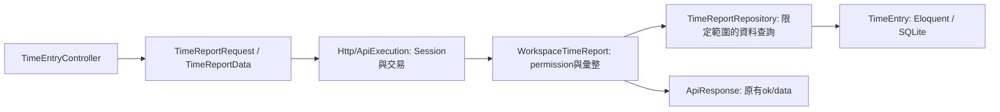

# 前後端架構重構紀錄

日期：2026-11-06（Asia/Taipei）。使用者恢復先前暫緩的重構，依專案內ECC laravel-patterns、Laravel Architecture與vue-best-practices整理既有系統。保留既有產品操作、Vue／Vuetify、JavaScript、Laravel、Session／CSRF、RPC、permission＋scope、revision／requestId及資料表。

## 責任調整

| 區塊 | 原本 | 現在 |
| --- | --- | --- |
| 帳號與HTTP | AccountService直接收Request、操作Auth與Session | AccountService回傳readonly AuthenticatedAccountData；Http/WorkspaceSession從Request取可信身分，Http/ApiExecution負責交易、Session及租戶標頭 |
| 即時頻道 | RealtimeController查資料、判權、開交易並簽章 | Controller只協調；Http/RealtimeSession維持交易與協定簽章；ProjectChannelAccess負責頻道格式與逐案permission |
| 工時輸入 | 通用JSON array一直傳到Service | TimeReportRequest明確allowlist、toDto回不可變TimeReportData，不接受操作者／工作區資格；原非HTTP入口相容轉DTO |
| 工時讀取 | RecordStore讀整個工作區工時、明細再讀全部卡片 | TimeReportRepository用Eloquent先限定工作區、可讀專案、日期、成員及有效工時；一次join回Collection<TimeReportEntryData>，不載入歷史／整個卡片集合 |
| 任務篩選 | App持有每個表單欄位、標籤、結果與分頁 | useIssueQuery擁有查詢及分頁；IssueFilters透過單一有界的篩選輸入v-model更新，元件自己擁有展開／收合；已移除條件不放寬結果 |
| 任務列表 | App內一長行模板做欄位查找及顯示 | IssueList只接本頁卡片與顯示資料，computed投影列，透過open事件傳回操作；保留原DOM類別與入口 |
| 卡片移動 | App持有移動旗標、重試Map及API錯誤流程 | useIssueTransitions擁有送出狀態、重試識別、防重複、版本衝突與過期回應；App協調保存後的工作區更新 |
| 提示與時間 | App維護兩個timer及清理 | useToast、useWorkspaceClock各自持有狀態與timer並在scope結束清理；Vue模板ref使用useTemplateRef |

表單驗證在Controller前執行；圖中箭頭表示資料責任，不代表Controller手動呼叫Laravel驗證生命週期。工作區與操作者由伺服器Session重新驗證，DTO不承擔授權。Service取得可讀專案清單後才傳給Repository；Repository不比較角色、建立HTTP回應或自行提交交易。

## 改功能時的入口

- 修改工時查詢格式：TimeReportRequest／TimeReportData；查詢資料或投影：TimeReportRepository；授權及加總：WorkspaceTimeReport。一般總覽不讀填報說明，明細只有需要展開時才取說明。
- 修改任務篩選規則：domain/filters與useIssueQuery；控制項：IssueFilters；表格欄位：IssueList。App繼續協調導覽、離頁草稿確認與跨工作區清理，不把整份App搬成單一巨大composable。
- 調整卡片移動重試或競態：useIssueTransitions；網路重試沿用相同版本／內容的requestId，切換工作區／專案或卸載後不將晚到回應寫入新畫面。
- 調整登入後Session：Http/ApiExecution／WorkspaceSession；帳號建立、密碼驗證及工作區資格：AccountService。帳號服務可在非HTTP環境呼叫，但交易仍由呼叫端持有。

## 保留的相容邊界

這輪處理的是共用HTTP邊界、工時查詢及App任務功能的責任拆分，不宣稱整個程式庫已全面完成新規範遷移。

- 其他既有寫入服務仍使用RecordStore array及JsonOperationRequest，保留原始receipt簽章、revision、歷史及交易。後續按用例改專用Request／DTO，不能一次改欄位或過濾未知欄位而改變重試語意。
- RecordStore／RelationalRecords是既有業務欄位與關聯式表的相容層，沒有改回JSON儲存；本輪不重建schema或重設使用者資料。
- 工時改為SQL限定查詢，群組聚合及群組分頁仍在記憶體，尚未實作SQL群組分頁或大資料量壓測。
- App仍擁有路由、帳號／工作區、草稿保護及跨功能更新。沒有額外安裝Router／Pinia、改TypeScript、改框架或重做介面。
- UI／UX以既有產品決策及介面為基準，瀏覽器回歸驗證可見操作；不是重新設計或真人使用者研究。

## 驗證

- 基線：後端59項／2391 assertions及production build通過。
- HTTP階段：既有59項通過；新增AccountDomainTest驗證無HTTP登入副作用、可從非HTTP取得資格及呼叫端交易回滾。
- 查詢階段：完整61項／2416 assertions通過；新測試讓不同工作區的專案／卡片／工時具有相同公開ID，驗證只讀指定租戶、必要欄位及單次查詢，保留原有日期、明細、作廢與撤權測試。
- 前端狀態檢查：`node frontend/tools/refactor-composables-check.js`驗篩選、分頁、已移除條件、重試識別、防重複、跨工作區及卸載的過期回應。此處替換外部API只測Vue生命週期，不取代真實API整合。
- 整合：使用本輪獨立tmpfs SQLite API及真實瀏覽器，完整browser-check、workspaces、time-analysis、member-time及board皆通過；實際Reverb驗證兩帳號同步、停啟後補抓、草稿409、撤權清除及CSRF／三尺寸通過。不使用業務資料庫。修正既有測試「關閉任務」模糊定位，避免匹配看板新增已關閉任務按鈕。
- 當前build仍有既有的500KB chunk提示，本輪不以新增套件或全站拆包擴大重構。

已人工檢視本輪桌面列表及手機篩選截圖；分頁、搜尋、狀態多選、標籤移除及原列表顯示維持一致。測試產物與日誌不提交；主服務只重啟受影響queue／websocket，未部署或重設業務資料。

## 重構前後評價

本節是2026-11-06依使用者要求的事後檢視，對照`f71969e`與`78f1470`的程式及前述驗證；不是再實作一次，也沒有追加壓測或真人使用研究。

判斷：值得做，而且有實質的責任與查詢改善。後端改善比前端更明顯，但目前仍是新舊架構並存的過渡期。

| 面向 | 重構前 | 重構後與實際限制 |
| --- | --- | --- |
| 後端可讀性 | 帳號、HTTP／Session及即時授權混在服務或Controller | Session與協定回HTTP邊界，帳號及頻道授權可單獨閱讀；ApiExecution仍是多用例協調入口，不代表已全面解耦 |
| 查詢成本 | 分析前載入工作區全部工時，明細另載全部卡片 | SQL先限定租戶、可讀專案、期間及成員，一次join投影；只證明讀取範圍改善，沒有毫秒、記憶體或吞吐的比較量測，聚合／分頁仍在記憶體 |
| 前端責任 | App內管理表單欄位、查詢、列表、移動重試及timer | 查詢、畫面及非同步生命週期各有owner；App仍563行，包含導覽、工作區、待辦與草稿協調。622→563行不是品質評分或全面拆分完成的證據 |
| 可測性與風險 | 主要依賴API與瀏覽器整合 | 增加非HTTP帳號、交易回滾、跨租戶相同公開ID及Vue過期回應的直接證據；59→61項後端測試及真實整合回歸支持行為延續，不代表正式環境沒有問題 |
| 維護成本 | 單檔易找，但修改容易牽動多種責任 | 修改入口明確，但必須跨檔追蹤；新DTO／Repository與其他用例的array／RecordStore並存，需靠文件與後續漸進遷移保持一致 |

新增的主要單位有實際用途：隔離HTTP副作用、限制資料查詢或共同管理重試／清理。沒有理由為每個Model或簡單操作再機械增加三層；useToast／useWorkspaceClock保持小型即可，不應為縮短App而持續拆出沒有獨立責任的檔案。

主要未完成的一致性工作是其他寫入用例的專用Request／DTO與資料入口，而不是繼續改檔名。FormRequest驗HTTP格式、DTO保護非HTTP條件的分工合理，但重複涉及頁碼／日期規則，變更時需同步驗證兩個入口。原始receipt簽章的欄位與順序語意必須保護，不能直接將所有寫入payload換成allowlist後視為無痛相容。

助理建議（未視為使用者採納）：優先遷移常改的任務及工時寫入用例，再評估App內導覽與工作區生命週期；大資料量SQL聚合／群組分頁待實測安排。這輪沒有修改產品行為，文件只做一致性與diff檢查，不重跑業務測試。
